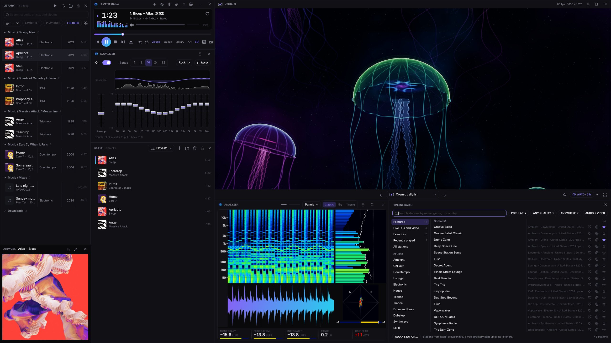
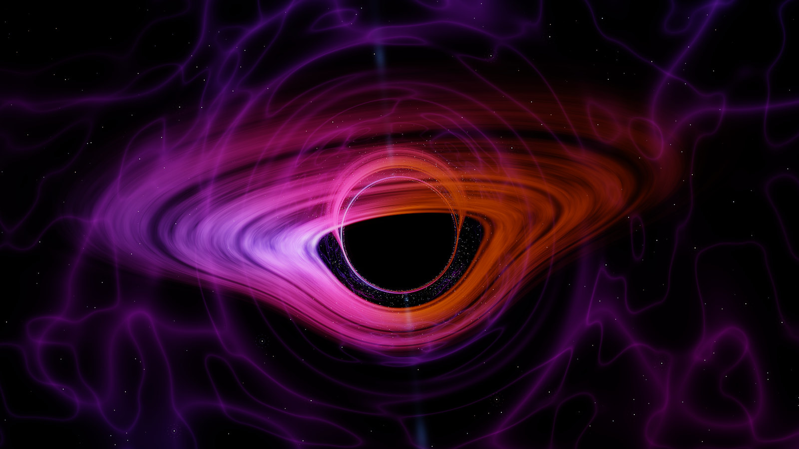
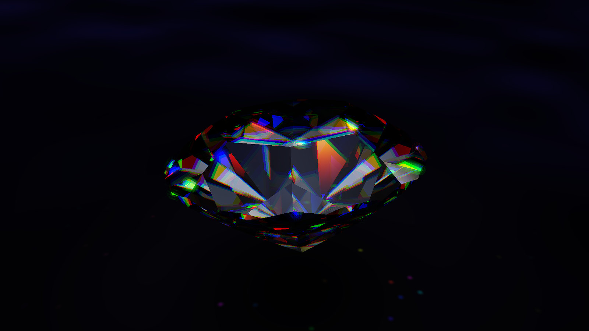
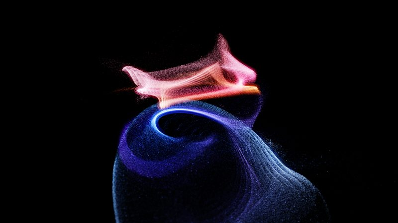
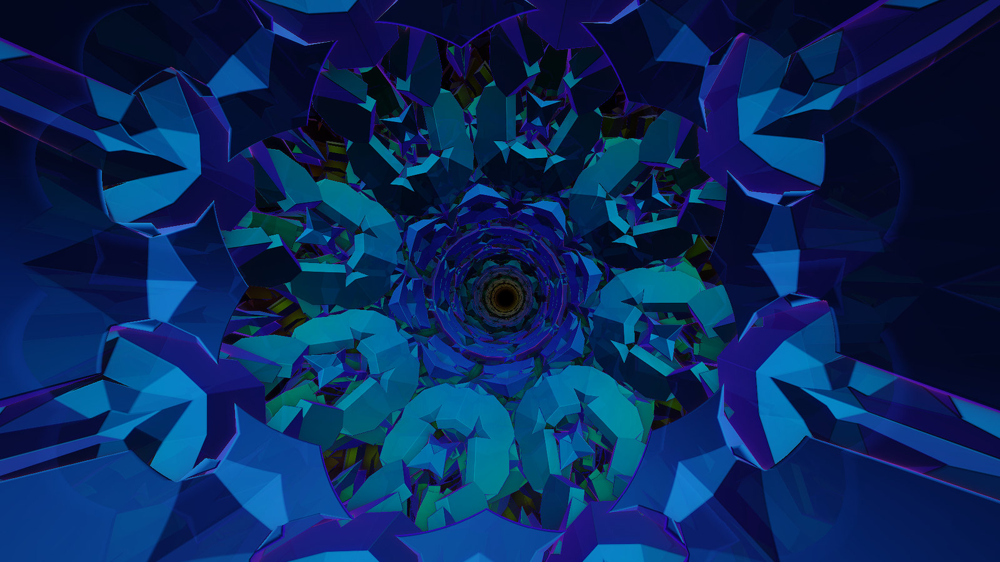
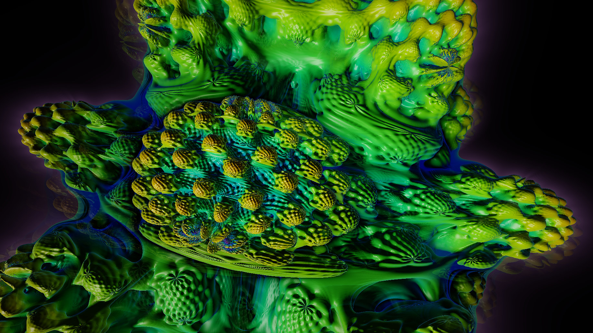
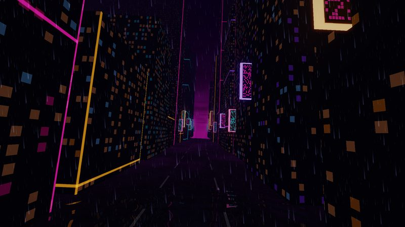
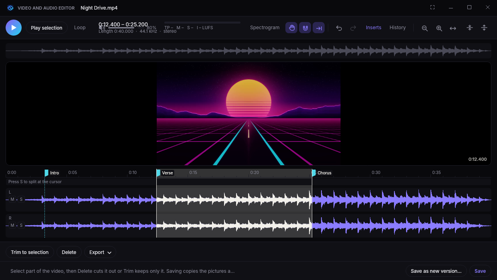
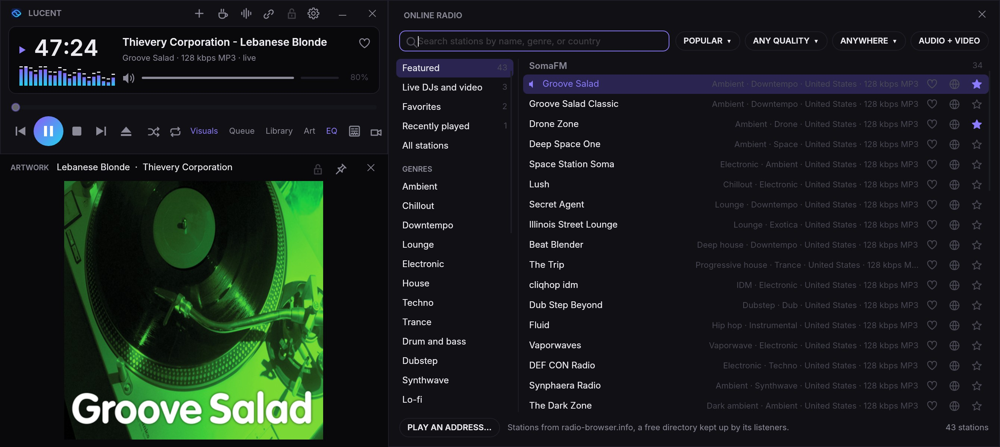

<p align="center"></p>

<h1 align="center">Lucent</h1>

<p align="center"><b>A spiritual successor to Winamp, built for audio nerds.</b><br>
A free music player for Windows and Mac, with 451 live GPU visuals, a video and audio editor, a studio analyzer, and a 32-band EQ.</p>

<p align="center">
  <a href="../../releases/download/latest/Lucent-Setup.exe"></a>
  <a href="../../releases/download/latest/Lucent-Setup-mac-arm64.pkg"></a>
  <a href="https://lucentaudio.net"></a>
</p>



## What's inside

- **451 visuals**, drawn live on your graphics card: 201 Lucent originals (ray-traced scenes, particle storms, fractals, and more), 216 MilkDrop presets, and 34 Winamp AVS presets. They know the song's build-ups and drops, even on radio.
- **Windows like Winamp's.** Player, library, queue, equalizer, analyzer, artwork, and visuals snap together and move as one. Drag one onto another to swap them, or press Shift+F11 to tile them all full screen.
- REMOVE tiles them all full screen.
- **Video and audio editor.** Cut, repair, master, split stems with AI, find loops, and run VST3 effects. Trim MP4 and MOV without re-encoding.
- **Analyzer.** Spectrogram, waveform, spectrum, stereo scope, and LUFS loudness (momentary, short-term, integrated, range, and true peak) for everything you play.
- **Studio equalizer.** 4 to 32 faders over the live spectrum, with 15 presets.
- **Skins and themes.** Five skins, eight themes, Lucent Classic for the full Winamp 2 look, and any .wsz skin.
- **Internet radio.** Thousands of stations, SomaFM and friends up front, and live video from The Lot Radio.
- **Your streaming apps, too.** Spotify, Apple Music, TIDAL, Pandora, SoundCloud, and YouTube play with Lucent's visuals and controls.
- **Sounds right.** Gapless, bit-perfect exclusive mode, and 15 formats from MP3 and FLAC to WavPack and APE.

<table>
<tr>
<td width="33%"><br><sub><b>Black Hole</b></sub></td>
<td width="33%"><br><sub><b>Diamond Fire</b></sub></td>
<td width="33%"><br><sub><b>Galaxy Collision</b></sub></td>
</tr>
<tr>
<td><br><sub><b>Kaleido Cathedral</b></sub></td>
<td><br><sub><b>Mandelbulb Bloom</b></sub></td>
<td><br><sub><b>Neon Downpour</b></sub></td>
</tr>
</table>

<table>
<tr>
<td width="50%"><br><sub><b>Video and audio editor</b></sub></td>
<td width="50%"><br><sub><b>Internet radio</b></sub></td>
</tr>
</table>

See everything at **[lucentaudio.net](https://lucentaudio.net)**.

## Download

| | |
|---|---|
| **Windows 10 or 11** | [`Lucent-Setup.exe`](../../releases/download/latest/Lucent-Setup.exe), or the portable [`Lucent-win-x64.zip`](../../releases/download/latest/Lucent-win-x64.zip) |
| **Mac, Apple silicon** | [`Lucent-Setup-mac-arm64.pkg`](../../releases/download/latest/Lucent-Setup-mac-arm64.pkg) |
| **Mac, Intel** | [`Lucent-Setup-mac-x64.pkg`](../../releases/download/latest/Lucent-Setup-mac-x64.pkg) |

Windows installs for your account, with no admin rights. If SmartScreen warns, click **More info**, then **Run anyway**. The Mac app needs macOS 12 or later and is signed and notarized by Apple. Any Direct3D 11 or Metal GPU works; a recent one gets you Ultra detail and 4K.

Lucent updates itself when you close it. Choose **Every build** or switch off automatic installs under **Options → Updates**. All files are on the [Latest build](../../releases/tag/latest) release.

## Keyboard shortcuts

| Playback | | Windows | | Visuals | |
|---|---|---|---|---|---|
| `Space` | Play or pause | `W` `Q` `L` | Visuals, queue, library | `V` | Visual picker |
| `Z` / `X` | Previous, next | `E` `Y` `C` | Equalizer, analyzer, artwork | `N` / `B` | Next visual, back |
| `S` / `R` | Shuffle, repeat | `D` `G` `K` | Dock, fill, shrink | `A` | Auto mode |
| `H` | Favorite | `J` | Link windows to the player | `F` | Star the visual |
| `Ctrl+I` | Edit sound info | `O` / `M` | Options, Sources | `F11` / `Shift+F11` | Fullscreen visuals, full-screen layout |

Media keys work in the background, and the playing song shows in Windows' media controls and the Mac's Now Playing.

## Make your own visuals

Each visual is one HLSL shader in [`src/WinampInspiredVisualizer/Presets`](src/WinampInspiredVisualizer/Presets), or the `Presets` folder next to the app. Both platforms load the same files.

```hlsl
// Name: My Visual
// Family: Kaleidoscope
// Tags: Calm, Neon
float3 Render(float2 uv, float2 p)
{
    float3 trail = previous(toUv(p * 1.02)) * 0.92;   // last frame, zoomed in a little
    float ring = glow(length(p) - 0.4 - Bass * 0.2, 120.0);
    return trail + hsv2rgb(Time * 0.1, 0.8, 1.0) * ring;
}
```

Inputs like `Bass`, `Mid`, `Treble`, `Beat`, `spectrum(x)`, and `waveform(x)`, and helpers like `kaleidoscope`, `glow`, `fbm`, and `cameraRay`, are in [`Shaders/Common.hlsli`](src/WinampInspiredVisualizer/Shaders/Common.hlsli). Your own `.milk` and `.avs` presets import too. MilkDrop and AVS credits are in each preset folder's `CREDITS.md`.

## Build from source

You'll need the [.NET 8 SDK](https://dotnet.microsoft.com/download/dotnet/8.0).

```
dotnet run --project src/WinampInspiredVisualizer   # Windows
dotnet run --project src/Lucent.Mac                 # Mac
```

| Project | What it is |
|---|---|
| [`src/Lucent.Core`](src/Lucent.Core) | Everything platform-free: audio analysis, EQ, editor effects, tags, library, and settings |
| [`src/WinampInspiredVisualizer`](src/WinampInspiredVisualizer) | The Windows app (WPF, Direct3D 11) |
| [`src/Lucent.Mac`](src/Lucent.Mac) | The Mac app (Avalonia, Metal, Core Audio) |
| [`src/PluginHost`](src/PluginHost) | The VST3 plugin helper (C++, built with CMake) |

The Mac app needs the visuals translated to Metal first, which takes Microsoft's [`dxc`](https://github.com/microsoft/DirectXShaderCompiler/releases) on Linux or Windows: `dotnet run --project tools/MetalShaders -- src/WinampInspiredVisualizer artifacts/metal-shaders`.

Windows and Mac stay at feature parity. A change to one goes into the other in the same pull request, and the few exceptions are listed in [`docs/PARITY.md`](docs/PARITY.md). Every push to main builds both and replaces the [Latest build](../../releases/tag/latest).

## Bugs and crash reports

Click **🐞 Report a bug** in Lucent's options to open a [bug report](../../issues/new?template=bug_report.yml) with the details filled in. Crashes are reported automatically, without your name, files, or music. Turn that off under **Options → Updates**.

## Support Lucent

Lucent is free, and always will be. If it's earned a spot in your setup, you can [buy me a coffee](https://buymeacoffee.com/joshuadav86).

## License

[MIT](LICENSE). Not affiliated with or endorsed by Winamp.

<details>
<summary>Third-party credits</summary>

- Stem splitting uses [Demucs](https://github.com/facebookresearch/demucs) by Meta AI ([MIT](tools/StemModel/LICENSE-Demucs.txt)), run with [ONNX Runtime](https://github.com/microsoft/onnxruntime) (MIT).
- MP3s are made with [LAME](https://lame.sourceforge.io/) (LGPL), shipped as separate `libmp3lame` libraries you can swap for your own build, through [NAudio.Lame](https://github.com/Corey-M/NAudio.Lame) (MIT).
- Videos play with [libVLC](https://www.videolan.org/vlc/libvlc.html) (LGPL 2.1 or later) through [LibVLCSharp](https://code.videolan.org/videolan/LibVLCSharp) (LGPL 2.1 or later). libVLC ships unchanged in the `libvlc` folder and can be swapped for your own build; its licence and source are in `Licenses/LICENSE-libVLC.txt`. VLC is a trademark of VideoLAN, which doesn't make or endorse Lucent.
- WavPack and Monkey's Audio decoding are C# ports of the [WavPack](https://github.com/dbry/WavPack) decoder by David Bryant ([BSD](assets/licenses/LICENSE-WavPack.txt)) and the [Monkey's Audio](https://www.monkeysaudio.com) decoder by Matthew T. Ashland ([BSD 3-Clause](assets/licenses/LICENSE-MonkeysAudio.txt)).
- The plugin helper is built with the [VST 3 SDK](https://github.com/steinbergmedia/vst3sdk) (MIT). VST is a registered trademark of Steinberg Media Technologies GmbH.
- The starter song, "Self Actualize," is © Kepler North and isn't covered by the MIT license.

</details>
