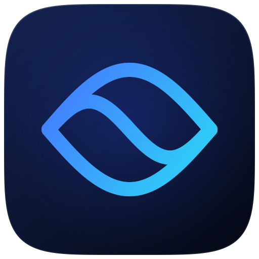

<p align="center"></p>

# Lucid

A modern, open-source music player for Windows with GPU-powered visualizations inspired by the classic Winamp era.

> Early days: the music player, GPU visualizer, options and themes work.

## Features

- Plays MP3, FLAC, WAV, AAC/M4A, ALAC, WMA, OGG Vorbis, Opus and AIFF
- Add files or whole folders, or drag them onto the window
- Playlist with play, pause, stop, previous, next, seek and volume
- A music library: link a folder and every song inside it is listed, newest first, with other sort orders and folder headings you can open or close
- Library and Queue switches in the title bar show or hide each side panel, for a bigger view of the visuals
- Shows track title, artist and length from the file's tags
- GPU visualizer (Direct3D 11) that reacts to bass, mids, treble and beats, with MilkDrop-style feedback trails
- 72 visuals in six families:
  - **Fly-through worlds:** Menger Voyage, Gyroid Caverns, Hyperspace Rings, Mandelbox Tunnel, Fractal Temple, Crystal Cavern, Wormhole Transit, Folded Metropolis, Kleinian Reef, Fibre Optic Braid and more
  - **Kaleidoscopes and sacred geometry:** Crystal Kaleidoscope, Kaleido Cathedral, Sacred Geometry, Rose Window, Metatron's Cube, Flower of Life, Penrose Mosaic, Prism Mandala, Lotus Bloom, Droste Zoom and more
  - **Fractals:** Julia Kaleidoscope, Apollonian Lace, Mandelbrot Dive, Mandelbulb Bloom, Burning Ship, Kleinian Limit, Newton Basins, Kali Flame, Koch Snowflake, Fractal Forest and more
  - **Music-shaped:** Spectrum Tunnel, Neon Oscilloscope, Cymatic Plate, Pulsar Ridges, Spectral Sunflower, Spectrum Galaxy, Lissajous Laser, Plasma Orb, Caustic Rings, Beat Shards and more
  - **Cosmic and organic:** Bass Nebula, Aurora Veil, Black Hole, Cosmic Jellyfish, Supernova Remnant, Electric Storm, Ink Flow, Chrome Blobs, Shot Silk, Living Cells and more
  - **Particles:** hundreds of thousands of glowing particles moving on the graphics card every frame: Strange Attractors, Galaxy Collision, Firework Mandala, Silk Currents, Sonic Dandelion and Knot Stream
- A visual picker: click the visual's name in the player bar (the button with the screen-and-spark icon), or press V, to choose any visual from a list
- Smooth transitions between visuals, including morphs where one visual melts, glows, flies or folds into the next, and an Auto mode that moves to a new visual on the beat every 25 seconds or so. The AUTO pill in the player bar shows how often; click the arrow beside it (or right-click the pill) to choose anything from 10 seconds to 3 minutes
- Options (the gear in the title bar, or O):
  - **Resolution:** draw visuals at the window's size, or at 1080p, 1440p or 4K. Above the window's size they're drawn bigger and shrunk to fit (supersampling), for smoother, finer detail
  - **Detail:** Low to Ultra, for more ray-marching steps and deeper fractals in the 3D and fractal visuals, and up to four times as many particles in the particle visuals
  - **Glow:** how strongly bright parts bloom, from off to strong
  - **HDR:** on screens with HDR turned on in Windows, highlights shine brighter than normal white
  - How often Auto mode changes visual, how long transitions take, morphs only, and an optional frame rate readout (shown in the player bar, next to the visuals)
- Eight themes for everything around the visuals: Midnight, Deep Ocean, Glacier (light), Ultraviolet, Emerald, Ember, Graphite and Rosé
- Remembers the last visual, your options and your theme
- Visuals compile in the background and are kept on disk, so the app starts straight away
- Fullscreen visuals: double-click the visualizer or press F11

**Shortcuts:** Space plays or pauses, Enter plays the selected track, Delete removes selected tracks from the playlist, N and B switch to the next or previous visual, V opens the visual picker, L and Q show or hide the library and queue, O opens options, A turns Auto mode on or off, F11 toggles fullscreen and Esc leaves it.

## Download and run

1. Go to the [Latest build](../../releases/tag/latest) release.
2. Download `Lucid-win-x64.zip` and unzip it.
3. Double-click `Lucid.exe`.

Nothing needs installing. If Windows SmartScreen warns about an unknown app, click **More info**, then **Run anyway**.

## Roadmap

1. Project setup and automatic builds
2. Music player: play, pause, seek, volume, playlist, and wide format support via FFmpeg
3. Visualizer engine: live audio analysis driving GPU shaders, with starter visuals
4. Themes, community visual presets, and a contributor guide

## Making your own visuals

Each visual is one HLSL pixel shader file in [`src/WinampInspiredVisualizer/Presets`](src/WinampInspiredVisualizer/Presets) (and in the `Presets` folder next to the app once downloaded). A preset defines one function:

```hlsl
// Name: My Visual
float3 Render(float2 uv, float2 p)
{
    float3 trail = previous(toUv(p * 1.02)) * 0.92;   // last frame, zoomed in a little
    float ring = glow(length(p) - 0.4 - Bass * 0.2, 120.0);
    return trail + hsv2rgb(Time * 0.1, 0.8, 1.0) * ring;
}
```

`Bass`, `Mid`, `Treble`, `Beat`, `Level`, `Time`, `spectrum(x)`, `waveform(x)` and helpers like `previous`, `rotate`, `kaleidoscope`, `palette`, `neon`, `polygon`, `glow`, `fbm` and `cameraRay` (for fly-through visuals) are listed in [`Shaders/Common.hlsli`](src/WinampInspiredVisualizer/Shaders/Common.hlsli). `qualitySteps(n)` and `fractalDepth(n)` scale loops with the Detail option, and `pixelSize()` keeps thin lines one screen pixel wide at every Resolution setting. Drop a new `.hlsl` file into the `Presets` folder and restart the app to see it. Every pull request checks that all presets compile.

A particle visual also defines `Spawn`, `Simulate` and `Show`, which start, move and draw each of its particles; the engine runs them for every particle each frame on the graphics card and adds the glowing dots into a layer that `Render` reads with `particles(uv)`. A `// Particles: 300000` line sets how many run on Normal detail. Random numbers, 3D projection with lens blur, curl-noise flow and motion streaks are in [`Shaders/Particles.hlsli`](src/WinampInspiredVisualizer/Shaders/Particles.hlsli).

## Building from source

Requires the [.NET 8 SDK](https://dotnet.microsoft.com/download/dotnet/8.0) on Windows.

```
dotnet run --project src/WinampInspiredVisualizer
```

## License

[MIT](LICENSE). Not affiliated with or endorsed by Winamp.
