<p align="center"></p>

<h1 align="center">Lucent</h1>

<p align="center"><b>Built for audio nerds.</b><br>
Winamp's soul, a 2026 graphics card's muscle: a player, editor, and analyzer for Windows, with 202 live GPU visuals, ray-traced scenes, and particle storms that move to every beat.</p>

<p align="center">
  <a href="../../releases/tag/latest"></a>
  <a href="https://buymeacoffee.com/joshuadav86"></a>
</p>

<p align="center">
  
  
  
  
</p>

<p align="center">
  <a href="#202-visuals">Visuals</a> ·
  <a href="#the-player">Player</a> ·
  <a href="#equalizer">Equalizer</a> ·
  <a href="#analyzer">Analyzer</a> ·
  <a href="#skins-and-themes">Skins</a> ·
  <a href="#download-and-run">Download</a> ·
  <a href="#make-your-own-visuals">Make visuals</a>
</p>

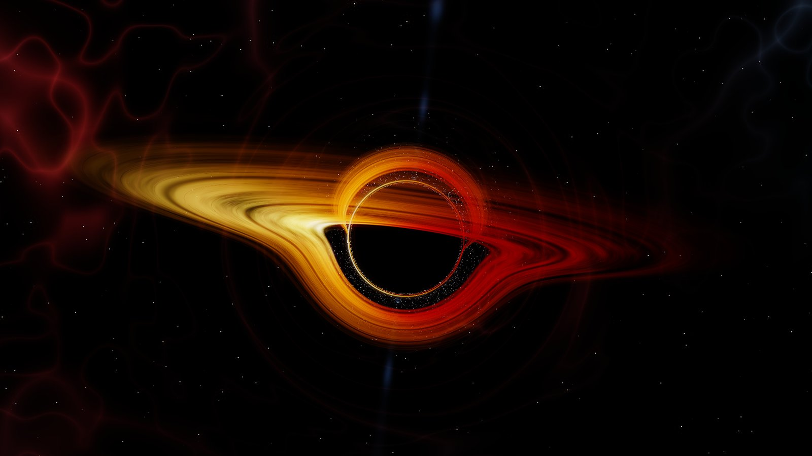

## At a glance

| | |
|---|---|
| ✨ **202 visuals** | Geometric patterns, minimal pieces, and endless fractals; ray-traced glass, chrome, and planets; and particle storms of fire, smoke, sparks, and starlings. |
| 📊 **Analyzer** | A scrolling spectrogram heatmap like Winamp's Vision plugin, with a live spectrum, waveform, and stereo spread scope. |
| 🎨 **Skins and themes** | Five skins change the shape, type, and finish of every window, and any skin goes with any of the eight themes. |
| 🎚️ **Studio equalizer** | 4, 8, 16, 24, or 32 mixing-desk faders over the music's live spectrum. |
| 🧲 **Snapping windows** | The player, equalizer, queue, library, and visuals snap together like Winamp's and move as one. |
| ✂️ **Built-in tools** | An audio editor, a converter, and a tag editor, all a right-click away. |

## 202 visuals

Every visual is drawn live on your graphics card and listens to the bass, mids, treble, and beat of what's playing. Auto mode studies each sound ahead of time and changes visual right on a downbeat, with morphs that melt, glow, fly, or fold one visual into the next.

### Ray traced

Physically lit 3D scenes with real reflections, glass that bends light, and soft shadows. 31 of them, from a diamond throwing rainbows to a whole planet under moving cloud.

<table>
<tr>
<td width="33%">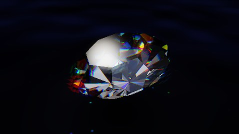<br><sub><b>Diamond Fire</b></sub></td>
<td width="33%">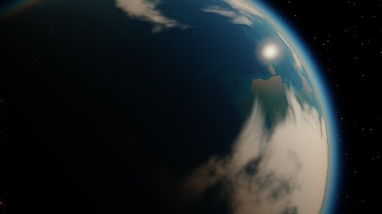<br><sub><b>Blue Marble</b></sub></td>
<td width="33%">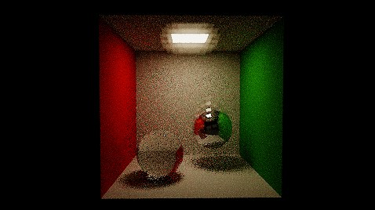<br><sub><b>Cornell Box</b></sub></td>
</tr>
<tr>
<td>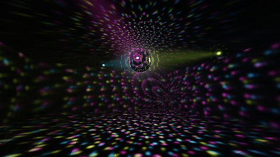<br><sub><b>Disco Ball</b></sub></td>
<td>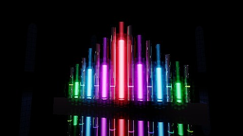<br><sub><b>Crystal Organ</b></sub></td>
<td><br><sub><b>Cloud Sea</b></sub></td>
</tr>
<tr>
<td>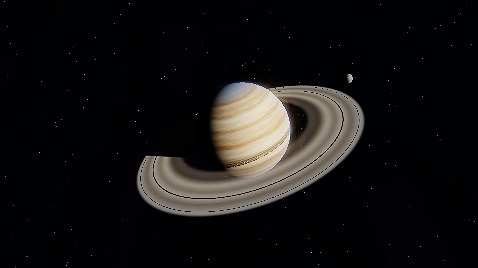<br><sub><b>Ringed World</b></sub></td>
<td>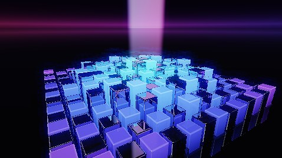<br><sub><b>Chrome Equalizer</b></sub></td>
<td>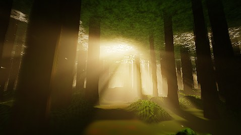<br><sub><b>Forest Light</b></sub></td>
</tr>
</table>

### Particles

Hundreds of thousands of glowing particles simulated on the graphics card every frame, with lens blur and motion streaks. 57 of them, and up to four times as many particles on Ultra detail.

<table>
<tr>
<td width="33%"><br><sub><b>Phoenix Rising</b></sub></td>
<td width="33%"><br><sub><b>Volcanic Eruption</b></sub></td>
<td width="33%">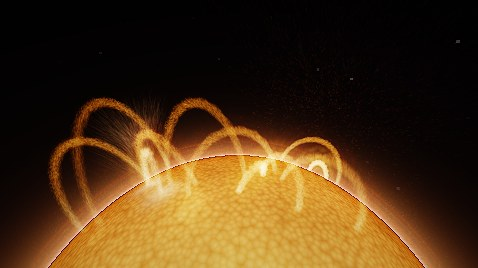<br><sub><b>Solar Flare</b></sub></td>
</tr>
<tr>
<td>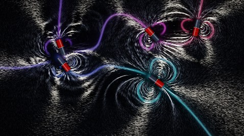<br><sub><b>Iron Filings</b></sub></td>
<td>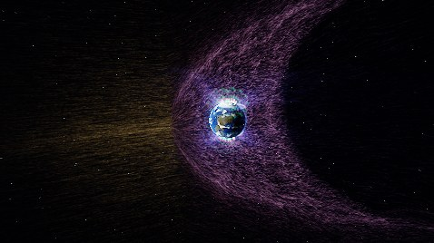<br><sub><b>Magnetosphere</b></sub></td>
<td><br><sub><b>Ember Storm</b></sub></td>
</tr>
<tr>
<td>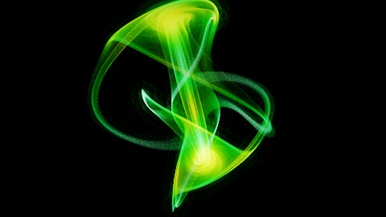<br><sub><b>Strange Attractors</b></sub></td>
<td>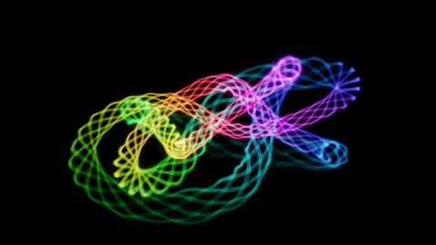<br><sub><b>Knot Stream</b></sub></td>
<td><br><sub><b>Dyson Swarm</b></sub></td>
</tr>
</table>

### Geometric, minimal, and fractal

Tilings, star polygons, and quasicrystals; a single ink circle or an eclipse that breathes with the bass; and fractals from glass trees to sphere foam you fly through.

<table>
<tr>
<td width="33%">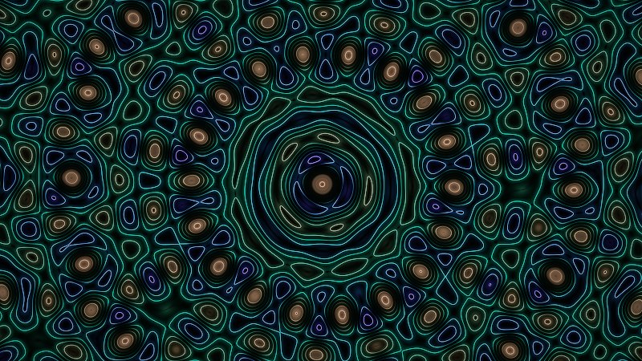<br><sub><b>Quasicrystal</b></sub></td>
<td width="33%">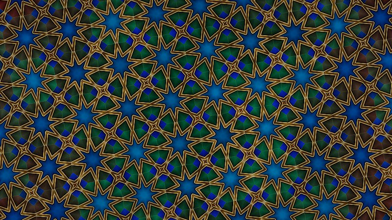<br><sub><b>Girih Tiles</b></sub></td>
<td width="33%"><br><sub><b>Voronoi Glass</b></sub></td>
</tr>
<tr>
<td>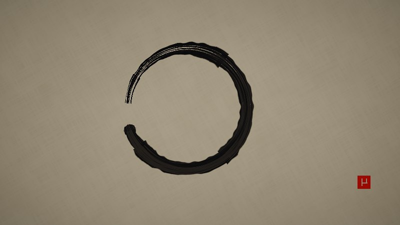<br><sub><b>Enso</b></sub></td>
<td>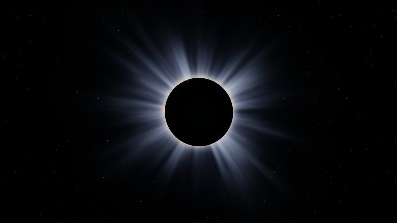<br><sub><b>Eclipse</b></sub></td>
<td>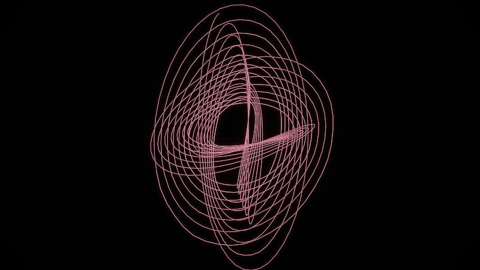<br><sub><b>Harmonograph</b></sub></td>
</tr>
<tr>
<td>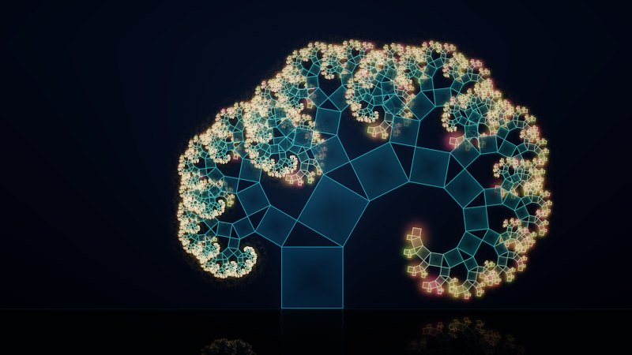<br><sub><b>Pythagoras Tree</b></sub></td>
<td>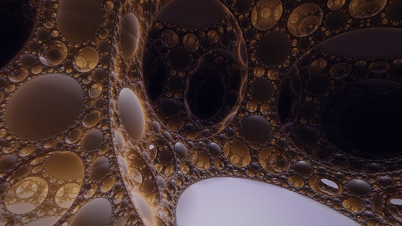<br><sub><b>Apollonian Spheres</b></sub></td>
<td>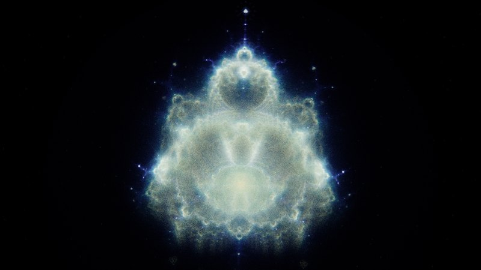<br><sub><b>Buddhabrot</b></sub></td>
</tr>
</table>

### Fractals, kaleidoscopes, and neon worlds

The MilkDrop spirit, rebuilt: fly through infinite fractals, stare into kaleidoscopes and sacred geometry, or cruise rain-soaked cyberpunk cities.

<table>
<tr>
<td width="33%">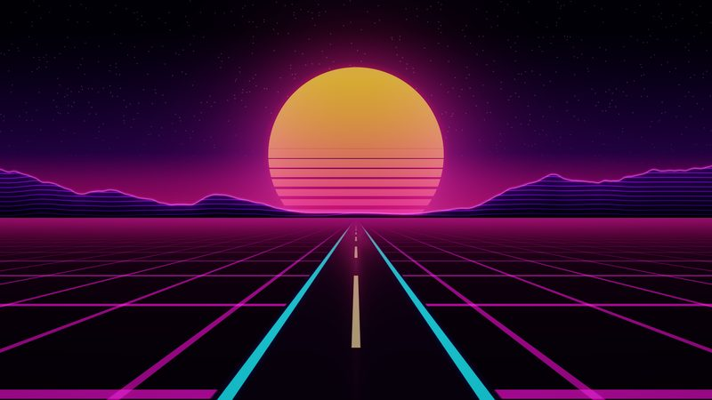<br><sub><b>Sunset Highway</b></sub></td>
<td width="33%">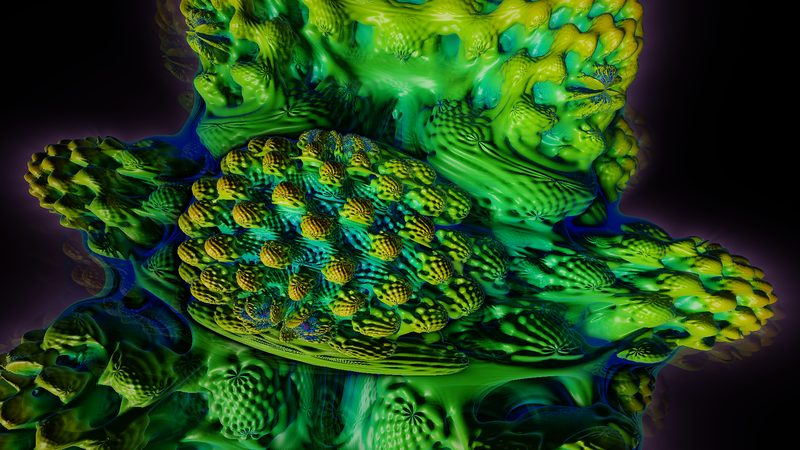<br><sub><b>Mandelbulb Bloom</b></sub></td>
<td width="33%">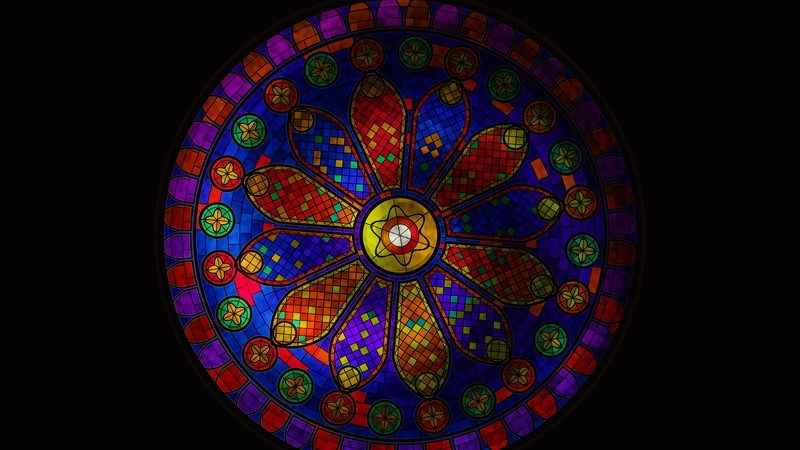<br><sub><b>Rose Window</b></sub></td>
</tr>
<tr>
<td>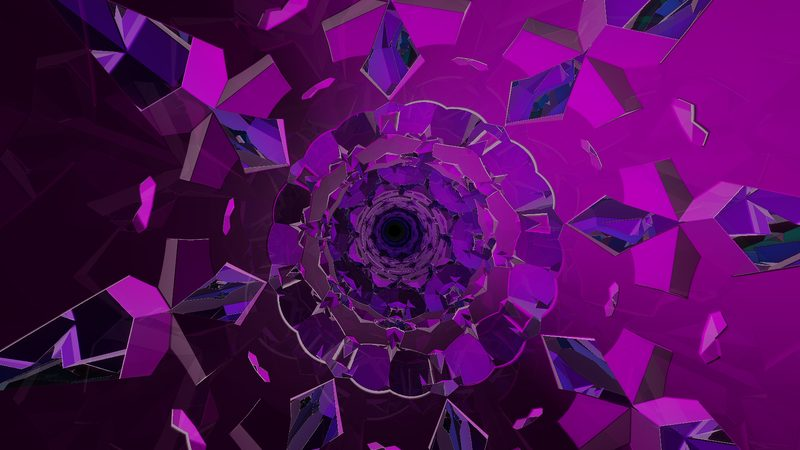<br><sub><b>Kaleido Cathedral</b></sub></td>
<td><br><sub><b>Neon Downpour</b></sub></td>
<td>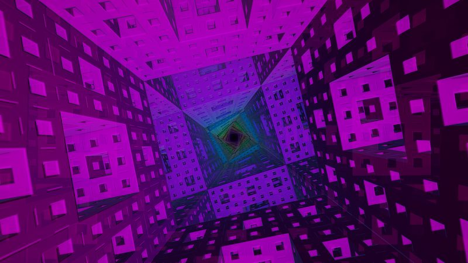<br><sub><b>Menger Voyage</b></sub></td>
</tr>
</table>

| Family | Visuals | A few favorites |
|---|---:|---|
| Particles | 57 | Galaxy Collision, Phoenix Rising, Murmuration, Buddhabrot, Physarum |
| Ray traced | 31 | Diamond Fire, Glass and Chrome, Hall of Mirrors, Disco Ball, Tesseract |
| Fractal | 26 | Mandelbulb Bloom, Pythagoras Tree, Apollonian Spheres, Burning Ship, Orbit Traps |
| Kaleidoscope | 15 | Kaleido Cathedral, Rose Window, Metatron's Cube, Flower of Life, Droste Zoom |
| Geometric | 15 | Quasicrystal, Girih Tiles, Voronoi Glass, Spirograph, Hilbert Curve |
| Minimal | 14 | Enso, Eclipse, Harmonograph, Horizon Line, Rothko Fields |
| Fly-through | 12 | Menger Voyage, Mandelbox Tunnel, Wormhole Transit, Gyroid Caverns |
| Music-shaped | 12 | Spectrum Tunnel, Cymatic Plate, Lissajous Laser, Pulsar Ridges |
| Cyberpunk | 7 | Neon Downpour, Sunset Highway, Folded Metropolis, Neon Alley |
| Organic | 6 | Aurora Veil, Ink Flow, Shot Silk, Living Cells |
| Cosmic | 5 | Black Hole, Bass Nebula, Cosmic Jellyfish, Supernova Remnant |

<details>
<summary><b>Graphics options</b></summary>

- **Resolution:** the window's size, or 1080p, 1440p, or 4K supersampled down for finer detail
- **Detail:** Low to Ultra, for more ray-marching steps, deeper fractals, and up to four times the particles
- **Glow:** how strongly bright parts bloom, from off to strong
- **HDR:** highlights shine brighter than white on HDR screens
- Transition length, morphs only, Auto timing from 10 seconds to 3 minutes, and a frame rate readout

</details>

### Find the right one in seconds

Press **V** and start typing. Visuals sit in family folders and carry tags (Calm, Intense, Neon, Space, Fire, 3D, and more). Star your favorites or make lists, and Auto mode, N, and B stick to what you picked.

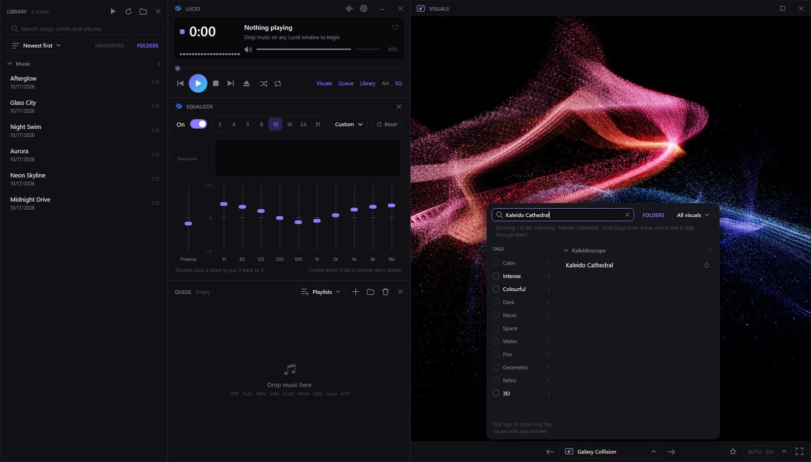

### Fullscreen, without losing control

Double-click the visuals or press **F11**. Click once to pause or play, and right-click for a seek bar, track controls, volume, and every graphics option.

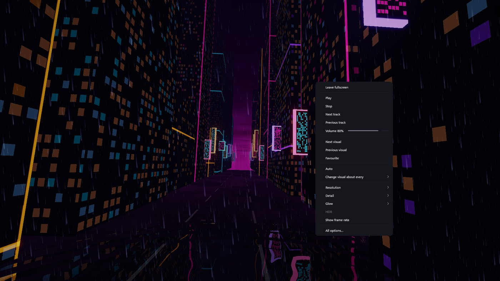

### Record a visual to video

Right-click the visuals and choose **Record video…** to save the song that's playing, drawn with a visual (or with Auto, changing on the beat), as an MP4 to share: the whole song or just a part, in 1080p, 1440p, or 4K at 30 or 60 fps. Every frame is drawn in turn and none are skipped, so a recording can take more or less time than the song lasts, and the visuals and music carry on as usual meanwhile. It's encoded as H.264 with AAC sound by Windows, on the graphics card when it can be.

## The player

A small player in the spirit of Winamp's, with the equalizer, queue, library, analyzer, artwork, and visuals each in their own window. Edges snap to each other and to the screen, docked windows travel together while you drag, and resizing one edge resizes its neighbours. Press **D** to tidy everything back into one neat rectangle, **G** to fill the screen, or **K** to shrink it all.

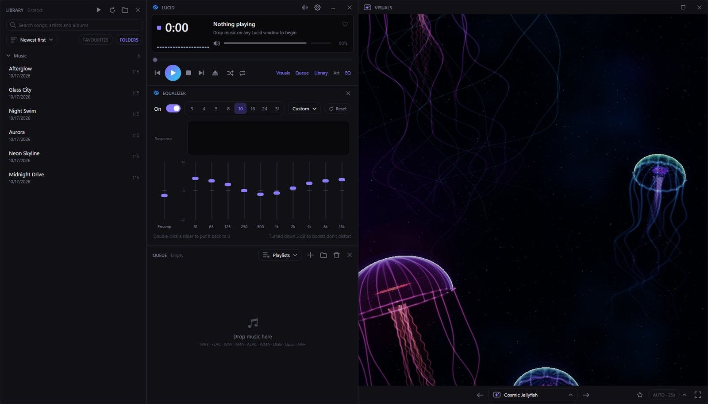

## Equalizer

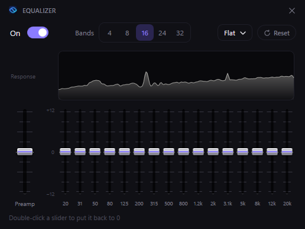

Docked under the player like Winamp's, with sliders styled after mixing-desk faders.

- **4, 8, 16, 24, or 32 bands.** Switching keeps your curve, and the new faders rise into place.
- **The music's live spectrum** sits behind the response curve, so problem frequencies show up as peaks.
- **15 presets** such as Bass Boost, Rock, Vocal, Late Night, and Small Speakers, or save your own.
- **Preamp and safe boosting.** Lucent lowers the volume a touch when you boost, so the music doesn't distort.
- The visuals react to the equalized sound.

<br clear="right">

## Analyzer

Open it with the heatmap button in the player, or **Y**. Four panels, and you choose which to show:

| Panel | What it shows |
|---|---|
| **Spectrogram** | The music as a heatmap scrolling right to left, low notes at the bottom, coloured by loudness. Point at it to read the frequency. |
| **Waveform** | The signal scrolling underneath, in step with the heatmap. |
| **Spectrum** | Bars on the same frequency scale right now, with peak marks. |
| **Stereo spread** | How wide the mix is, with a bar for how alike the left and right sides are. |

Pick Classic (blue through red), Fire, or Theme colours, and right-click to scroll slower or faster. It docks with the other windows, follows your skin and theme, and holds still while the music is paused so you can look closer.

## Skins and themes

Skins decide the shape, type, and finish of every window. Themes decide the colours. Each skin comes with a theme it was designed around, and any skin works with any theme.

| Skin | Look | Made for |
|---|---|---|
| **Lucent** | Soft corners, hairlines, and calm, modern type | Midnight |
| **Classic** | Square corners, raised buttons, and a black LCD, like the players of 1999 | Emerald |
| **Glass** | Frosted panes, soft light, and big round buttons | Deep Ocean |
| **Neon** | Hard edges that glow in the accent colour, over scan lines | Ultraviolet |
| **Studio** | Brushed metal and an inset display, like rack-mounted hi-fi gear | Graphite |

<p align="center">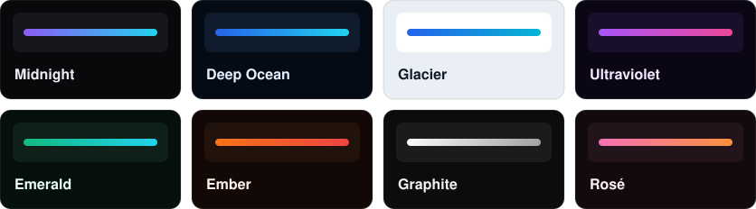</p>

## Everything else a music player needs

| | |
|---|---|
| 🎵 **Plays almost anything** | MP3, FLAC, WAV, AAC/M4A, ALAC, WMA, OGG Vorbis, Opus, and AIFF |
| 📚 **Library** | Link a folder and every sound shows up, searchable as you type |
| 🛒 **Bandcamp and Beatport** | Music you download from either store files itself into the library, and Bandcamp purchases can sync by themselves |
| 📥 **Import from another player** | Bring playlists, play counts, ratings and loved songs over from Apple Music or iTunes, MusicBee, foobar2000, Plex, or YouTube Music |
| ❤️ **Favorites and playlists** | Heart sounds, star visuals, and save .m3u8 playlists Winamp can open too |
| ✂️ **Audio editor** | Cut, copy, and paste with crossfades; a spectrogram view; meters and loudness analysis; EQ, compressor, and limiter; hum, click, and noise repair; tempo; mono conversion; and your own VST3 effects, with undo |
| 🔁 **Converter** | Make MP3, FLAC, or WAV, in mono if you like, with tags and artwork carried across and optional processing for a whole batch |
| 🏷️ **Tag editor** | Titles, artists, lyrics, and cover art, saved safely to a checked copy first |
| 🖼️ **Artwork window** | The playing sound's cover, as big as you like |

## Download and run

1. Download [`Lucent-Setup.exe`](../../releases/download/latest/Lucent-Setup.exe) from the [Latest build](../../releases/tag/latest) release.
2. Run it. Lucent installs for your Windows account (no admin needed), adds Start menu and desktop shortcuts, and opens.

Installed Lucent keeps itself up to date. It checks for a newer version when it starts and every hour while it runs, downloads it in the background, and installs it when you close Lucent; an **UPDATE** button appears in the title bar if you'd rather restart into it straight away. Your settings, playlists, and visuals are kept. It updates to stable releases; to get every new build as soon as it's made, choose **Every build** under **Options > Updates**. (Until the first stable release is out, everyone gets every build.) Uninstall it from Windows' **Installed apps** list.

If Windows SmartScreen warns about an unknown app, click **More info**, then **Run anyway**.

Rather not install? Download `Lucent-win-x64.zip` from the same release, right-click it and choose **Extract All**, then double-click `Lucent.exe`. That copy doesn't update itself.

### On a Mac

Lucent for the Mac is the same app (every window, the visuals drawn with Metal) and needs macOS 12 or later.

1. From the [Latest build](../../releases/tag/latest) release, download [`Lucent-Setup-mac-arm64.pkg`](../../releases/download/latest/Lucent-Setup-mac-arm64.pkg) for an Apple silicon Mac (M1 or later), or [`Lucent-Setup-mac-x64.pkg`](../../releases/download/latest/Lucent-Setup-mac-x64.pkg) for an Intel Mac. (**Apple menu > About This Mac** says which you have.)
2. Open it. Lucent installs into **Applications** and opens.

Installed Lucent keeps itself up to date just like on Windows, with the same **UPDATE** button in the title bar. Your settings, playlists, and visuals are in `~/Library/Application Support/Lucent` and are kept. To uninstall, drag Lucent from Applications to the Bin.

Lucent isn't signed by Apple yet, so the first time macOS says it can't check the installer (or the app). Open **System Settings > Privacy & Security**, scroll down, and click **Open Anyway**.

Rather not install? Download `Lucent-mac-arm64.zip` or `Lucent-mac-x64.zip`, open it, and double-click `Lucent.app` (drag it to Applications first if you like). That copy doesn't update itself.

## Keyboard shortcuts

Shortcuts work from any Lucent window, and your keyboard's media keys work while Lucent has focus.

| Playback | | Windows | | Visuals | |
|---|---|---|---|---|---|
| `Space` | Play or pause | `W` `Q` `L` | Visuals, queue, library | `N` / `B` | Next or previous visual |
| `Z` / `X` | Previous or next track | `E` | Equalizer | `V` | Visual picker |
| `S` | Shuffle | `Y` | Analyzer | `A` | Auto mode |
| `R` | Repeat off, all, or one | `C` | Artwork | `F` | Star the visual |
| `H` | Favorite the sound | `D` / `G` / `K` | Dock, fill, shrink | `F11` / `Esc` | Fullscreen, leave it |
| `Enter` / `Delete` | Play or remove selected | `O` | Options | `Ctrl+I` | Edit sound info |

<details>
<summary><b>The full feature list</b></summary>

- A small player window like Winamp's, with a big time display, a spectrum meter (click it for a waveform, or to hide it), a scrolling title, and the bitrate and sample rate
- The visuals, queue, library, equalizer, analyzer, and artwork each have their own window. Edges snap to each other and to the screen (keep dragging to pull a window free). A window dropped beside others with one corner lined up stretches a little to line up its other corner too. Dragging the player carries every window docked to it, even ones that are switched off, and docked windows stay together throughout the drag. Windows never end up overlapping by accident
- The equalizer opens docked under the player, with the queue below it. The visuals and library line up with the bottom of the column, so the windows form one neat rectangle whichever are open. Lucent remembers where you left them
- Resizing a window resizes the windows docked to it: drag the edge between two windows to move both, or an outside edge they share to stretch them together; hold Ctrl to resize just one
- On a first start, just the player, equalizer, and visuals open, with a song in the queue and the library to try it with: "Self Actualize" from Kepler North's *Pseudo Profound* EP. It sits in its own Starter Music folder, so take it out of the library like any other folder when you're done with it
- Add files or folders with the eject button, or drag them onto any Lucent window
- Queue with play, pause, stop, previous, next, seek, volume (the mouse wheel over the player works too), shuffle, and repeat all or one
- A music library, newest first, with other sort orders and folder headings you can open or close. Search by title, artist, album, or file name as you type (Ctrl+F); Esc clears it
- Bandcamp and Beatport: switch them on under **Bandcamp and Beatport…** in the library's folder menu, and Lucent watches your Downloads folder. Releases and tracks you download from either store are unpacked into Music\Bandcamp or Music\Beatport, a folder per artist and release, and show up in the library. The downloads stay where they are, and other zips and songs are left alone (each store tags the files it sells, which is how Lucent recognises them)
- Bandcamp collection sync (experimental): sign in to Bandcamp on its own page and Lucent downloads your purchases in the format you pick (FLAC, MP3, ALAC, AAC, or Ogg), then any new ones each time it starts. Bandcamp has no official way for apps to do this, so it uses the website's own pages and may need an update if Bandcamp changes them. The sign-in is kept encrypted for your Windows account only
- Import from another player: choose **Import from another player…** in the library's folder menu. Lucent reads iTunes' or Apple Music's library file (File > Library > Export Library), MusicBee's iTunes-style XML file, foobar2000's playlists (and .m3u, .pls, .xspf and .wpl files from other players), ratings and play counts saved in your files' tags, your Plex Media Server (sign in on Plex's own page), and YouTube Music playlists from a Google Takeout download. Each song is matched to the file in your library, by its path even if the music moved drives, or by artist and title. Playlists become Lucent playlists, loved songs become favorites, and plays and ratings show in the library, which can sort by most played, recently played, or rating. Nothing is downloaded from YouTube; songs you don't have are listed so you can find them
- Favorite sounds: the heart in the player (or H), or right-click sounds in the queue or library. The FAVORITES pill in the library shows only them
- Playlists: save the queue, add sounds from the queue or library, and play them from **Playlists** in the queue window. They're standard .m3u8 files
- Edit a sound's info (right-click it, or Ctrl+I): title, artist, album, album artist, year, track and disc, genre, composer, BPM, comment, and lyrics. Edit several sounds at once. Add, paste, remove, or save cover art; very large pictures are shrunk to 1600 pixels. New info is written to a checked copy before it replaces the original, and sounds keep their date so they stay put in the library
- An artwork window (Art in the player, or C) that uses the file's cover, or a folder.jpg, cover.jpg, or front.jpg next to it. Pin it on top, or copy or save the picture
- An audio editor (the waveform button in the player, or **Open in editor…** on a sound) showing both channels. Drag to select, the wheel zooms, and Space plays. Normalize to a peak of −0.1, −1, or −3 dB or a loudness of −14, −16, or −23 LUFS, change pitch by up to 12 semitones in 0.1 steps (keeping the speed or like a record), gain, fade in and out, trim, delete, silence, and reverse, with undo and redo. Right-click the waveform for all of these on the selection or the clip under the mouse. Press **S** to split at the cursor (or at the playhead while it plays, or around the selection), drag a clip's tab to move it, and add silence before, after, or in the middle of a clip. Save over the original after asking, or as a new version; formats Lucent can't write are saved as FLAC
- Editing tools in the editor: **cut, copy, and paste** (Ctrl+X, C, V, between sounds and to and from other programs) with every join crossfaded (0 to 50 ms, from the **Edit** menu); **Snap** to zero crossings (hold Ctrl to place exactly); a **Spectrogram** view (V); **Loop** playback of the selection (L); a level meter with true peak and momentary, short-term, and integrated LUFS while it plays; and **Analyze…** for peak, true peak, RMS, DC offset, loudness, loudness range, stereo correlation, the average spectrum, and a clipping finder that marks each clipped spot (F3 goes to the next)
- Built-in processing: a 7-band parametric **EQ** drawn over the selection's spectrum and a **compressor** or true-peak **limiter**, all heard live while you set them up; **Tempo** from 50 to 200% keeping the pitch or not; **Repair** for 50 or 60 Hz hum, clicks and crackle, background noise (learned from a quiet part), and DC offset; and **Channels** to swap, mix, invert, or widen; edit one channel alone (Alt+drag); or **convert to a mono file**
- **Stems…** splits the music into vocals, drums, bass, and the other instruments with Demucs, an AI model that runs on the graphics card (any DirectX 12 card on Windows, Core ML on a Mac) or on the processor. Keep any mix of them in the editor (**No vocals** for karaoke, **Only vocals** for an a cappella) as one step you can undo, or **Save stems as files** into a folder next to the sound. The model (about 85 MB) downloads the first time you use it
- **Markers** (M, and [ and ] to go between them) to name spots, select between them, or split at every one. Markers and clips aren't saved into the file
- VST3 effects in the editor (**Plugins**): reverbs, EQs, compressors, and anything else installed in the usual VST3 folder (or a folder you add). The plugin's own window opens; **Preview** plays the selection through it as you turn its knobs, and **Apply** changes the selection or the whole sound as one step you can undo. Reverb and delay tails ring on into the audio that follows, or lengthen the sound at the end. Each plugin runs in a helper program of its own, so one that crashes can't take Lucent or your edits with it, and its settings are remembered for next time. 64-bit VST3 effects only (not VST2, 32-bit plugins, or instruments)
- A converter (**Convert to…**): MP3 at 128 to 320 kbps or VBR V0 and V2, FLAC at 16 or 24-bit, or WAV at 16, 24, or 32-bit float, at the original sample rate or 44.1 or 48 kHz, in stereo or mono. Several sounds at once, optionally processed on the way (normalize, limit, change volume, use the editor's EQ or compressor, remove hum, clicks, or DC offset, trim silence, and fade in and out; also **Batch…** in the editor), tags and artwork copied, and nothing replaced without asking
- A Direct3D 11 visualizer with MilkDrop-style feedback trails, and visuals that compile in the background and are kept on disk, so the app starts straight away
- The visual picker lists visuals in family folders (switch them off with the FOLDERS pill) and filters by tag; CLEAR shows everything again. Enter shows the first match, Esc clears the search
- Favorite visuals and lists: star a visual in the picker, under the visuals, or with F. The menu at the top of the picker switches between all visuals, favorites, and your lists
- Auto mode moves to a new visual about every 25 seconds, on a downbeat at the start of a phrase where it can. The AUTO pill shows how often; click the arrow beside it to choose anything from 10 seconds to 3 minutes
- Fullscreen: double-click or F11. Leave with Esc, a double-click, the × in the top-right corner, or the right-click menu. Click once to pause or play, in a window or fullscreen
- The right-click menu on the visuals: fullscreen, a seek bar, play or pause, stop, next and previous track, volume, the next or previous visual, the picker, favorite, Auto and its timing, and the graphics options
- Remembers the last visual, your options, your skin, and your theme

</details>

## Make your own visuals

Each visual is one HLSL pixel shader file in [`src/WinampInspiredVisualizer/Presets`](src/WinampInspiredVisualizer/Presets) (and in the `Presets` folder next to the installed app). A preset defines one function:

```hlsl
// Name: My Visual
// Family: Kaleidoscope
// Tags: Calm, Neon
float3 Render(float2 uv, float2 p)
{
    float3 trail = previous(toUv(p * 1.02)) * 0.92;   // last frame, zoomed in a little
    float ring = glow(length(p) - 0.4 - Bass * 0.2, 120.0);
    return trail + hsv2rgb(Time * 0.1, 0.8, 1.0) * ring;
}
```

`Bass`, `Mid`, `Treble`, `Beat`, `Level`, `Time`, `spectrum(x)`, `waveform(x)`, and helpers like `previous`, `rotate`, `kaleidoscope`, `palette`, `neon`, `polygon`, `glow`, `fbm`, and `cameraRay` (for fly-through visuals) are listed in [`Shaders/Common.hlsli`](src/WinampInspiredVisualizer/Shaders/Common.hlsli). `qualitySteps(n)` and `fractalDepth(n)` scale loops with the Detail option, and `pixelSize()` keeps thin lines one screen pixel wide at every Resolution setting. The `// Family:` and `// Tags:` lines put a visual in a picker folder and give it tags (the families and tags are listed in [`Visualizer/VisualStyles.cs`](src/Lucent.Core/Visualizer/VisualStyles.cs); without them it goes in Other). Drop a new `.hlsl` file into `%AppData%\Lucent\Presets` on Windows or `~/Library/Application Support/Lucent/Presets` on a Mac (create the folder if it isn't there) and restart the app to see it. Visuals there survive updates, and one with the same file name as a built-in visual replaces it. Every pull request checks that all presets compile.

A particle visual also defines `Spawn`, `Simulate`, and `Show`, which start, move, and draw each of its particles. The engine runs them for every particle each frame on the graphics card and adds the glowing dots into a layer that `Render` reads with `particles(uv)`. A `// Particles: 300000` line sets how many run on Normal detail. Random numbers, 3D projection with lens blur, curl-noise flow, and motion streaks are in [`Shaders/Particles.hlsli`](src/WinampInspiredVisualizer/Shaders/Particles.hlsli).

### MilkDrop presets

Lucent plays MilkDrop presets (`.milk` files from Winamp's MilkDrop 1 and 2 and from projectM) as visuals on Windows, listed in the picker's MilkDrop folder. It comes with 148 classics picked from projectM's [Cream of the Crop](https://github.com/projectM-visualizer/presets-cream-of-the-crop) collection, by Geiss, Rovastar, Zylot, and many more (see [the credits](src/WinampInspiredVisualizer/Presets/MilkDrop/CREDITS.md)), and four of Lucent's own. Switch **MilkDrop presets** off in **Options → Visuals** (or the visuals' right-click menu) to leave them out of the picker and Auto. To add your own, press **Import** on the picker's MilkDrop folder, right-click the visuals and choose **MilkDrop presets → Import MilkDrop presets…** (or **Import a folder of presets…** for a whole pack), or drop them into `%AppData%\Lucent\Presets\MilkDrop` and restart; folders inside it load too. They're named the way preset packs name them: a file called `Geiss - Reaction Diffusion.milk` shows as **Reaction Diffusion by Geiss**, and the picker's search finds presets by author too. They work with Auto, favourites, lists, and the transitions like any other visual. Each preset runs as MilkDrop runs it: its per-frame and per-pixel equations (MilkDrop's expression language compiled to fast .NET code) bend a warp mesh that feeds each frame into the next, then its custom shapes, custom waves, built-in wave, borders, and motion vectors are drawn on top, and MilkDrop 2 warp and composite shaders are translated to Shader Model 5, with the blur and noise textures they expect. Bass, mid, and treble come from Lucent's own analysis, scaled the way MilkDrop scales them. A part of a preset that can't be used is left out (an equation that doesn't parse), swapped for MilkDrop 1's version (a shader that won't compile) or stood in for (a picture from MilkDrop's textures folder becomes noise), and noted in `%AppData%\Lucent\errors.log`; a file that isn't a preset at all is skipped. The code is in [`Lucent.Core/Visualizer/MilkDrop`](src/Lucent.Core/Visualizer/MilkDrop) (reading presets and running them, with no graphics card needed) and [`Visualizer/MilkDrop`](src/WinampInspiredVisualizer/Visualizer/MilkDrop) (drawing them with Direct3D); `dotnet run --project tools/MilkDropCheck -- <presets>` reads and runs presets without the app, and CI compiles the bundled presets' shaders.

## Build from source

Requires the [.NET 8 SDK](https://dotnet.microsoft.com/download/dotnet/8.0) on Windows.

```
dotnet run --project src/WinampInspiredVisualizer
```

The code is in three projects. `src/Lucent.Core` holds everything that doesn't depend on Windows (audio analysis, the equalizer, the editor's effects, export, tags, the library, playlists, and settings) and builds on any OS, for both apps. `src/WinampInspiredVisualizer` is the Windows app: its windows, the Direct3D renderer, playback, and the shaders. `src/Lucent.Mac` is the Mac app (see [Mac](#mac)).

VST3 plugins in the editor need the plugin helper, a small C++ program in [`src/PluginHost`](src/PluginHost). Build it first (with [CMake](https://cmake.org/) and Visual Studio's C++ tools) and the app build copies it next to `Lucent.exe`:

```
cmake -S src/PluginHost -B build/PluginHost -A x64
cmake --build build/PluginHost --config Release
```

### Mac

`src/Lucent.Mac` is the Mac app: the whole Windows app ported to [Avalonia](https://avaloniaui.net/), sharing `src/Lucent.Core` with it. The visuals are drawn with Metal, music plays through Core Audio, the Bandcamp sign-in uses Safari's WebKit and is kept in your keychain, and it updates itself with [Velopack](https://velopack.io/) like the Windows app. It needs macOS 12 or later and the .NET 8 SDK.

The visuals are written in HLSL, so they're translated to Metal when the app is built. That needs Microsoft's [DirectX Shader Compiler](https://github.com/microsoft/DirectXShaderCompiler/releases) (`dxc`) on your PATH, or set `DXC` to it. DXC has no Mac build, so run the first line on Linux or Windows (CI does it on Linux) and copy `artifacts/metal-shaders` across:

```
dotnet run --project tools/MetalShaders -- src/WinampInspiredVisualizer artifacts/metal-shaders
dotnet run --project src/Lucent.Mac
```

To make `Lucent.app`, publish it for your Mac's chip (`osx-arm64` for Apple silicon, `osx-x64` for Intel) and package it. `package-mac.sh` adds the icon and Info.plist and signs it ad hoc (set `MAC_SIGN_IDENTITY` to a Developer ID certificate's name to sign it properly):

```
dotnet publish src/Lucent.Mac -c Release -r osx-arm64 --self-contained -o publish-mac
tools/package-mac.sh publish-mac . 0.1.0
```

CI builds both chips on every push, each on its own kind of Mac: it runs `Lucent --self-test` (decoding, and every visual drawn on the graphics card), makes the zip of `Lucent.app`, and packs the installer and update feed with Velopack (`vpk pack`, in an `osx-arm64` or `osx-x64` channel so each Mac updates to its own build). On main, they're added to the Latest build release. Adding Apple signing and notarization later only needs the repository secrets listed in [`build.yml`](.github/workflows/build.yml).

### Releases

Every push to main replaces the **Latest build** release, and copies of Lucent set to **Every build** update to it. To make a stable release, run the **Release** workflow from the Actions tab once the Windows and both Mac builds of a commit have reached Latest build: it copies those exact files to a new release (tagged `v1.0.412`, say, with the title you give it) that everyone on stable releases then updates to. Afterwards, raise the first two numbers of `LUCENT_VERSION` in [`build.yml`](.github/workflows/build.yml) (1.0 to 1.1, say), so later builds count up from the new release.

`Lucent --screenshots <folder>` draws each window to a PNG without a screen (on any OS, Linux included), for checking the Mac windows by eye.

## Report a bug

Found something broken? Click **🐞 Report a bug** at the bottom of Lucent's options panel. It opens a [bug report](https://github.com/joshuadav86/Lucid/issues/new?template=bug_report.yml) on GitHub with your Lucent version, Windows version, graphics card, and the last few errors from `%AppData%\Lucent\errors.log` already filled in. Nothing is sent until you check it and click **Create**. You'll need a free GitHub account.

## Support Lucent

Lucent is free. If it's earned a place on your desktop, you can [buy me a coffee](https://buymeacoffee.com/joshuadav86). The coffee cup in Lucent's title bar and the **☕ Buy me a coffee** button at the bottom of its options panel go to the same page.

## License

[MIT](LICENSE). Not affiliated with or endorsed by Winamp.

The audio editor's stem splitter uses [Demucs](https://github.com/facebookresearch/demucs) by Meta AI ([MIT](tools/StemModel/LICENSE-Demucs.txt)), run with [ONNX Runtime](https://github.com/microsoft/onnxruntime) (MIT).

The starter song (`StarterMusic/Kepler North - Self Actualize.mp3`) is © Kepler North and isn't covered by the MIT licence; it comes with Lucent to be played in it.

MP3s are made with [LAME](https://lame.sourceforge.io/) (LGPL), which ships as the separate `libmp3lame.64.dll` and `libmp3lame.32.dll` next to `Lucent.exe` and can be swapped for your own build. It's used through [NAudio.Lame](https://github.com/Corey-M/NAudio.Lame) (MIT).

The plugin helper (`LucentPluginHost.exe`) is built with the [VST 3 SDK](https://github.com/steinbergmedia/vst3sdk) (MIT). VST is a registered trademark of Steinberg Media Technologies GmbH.
